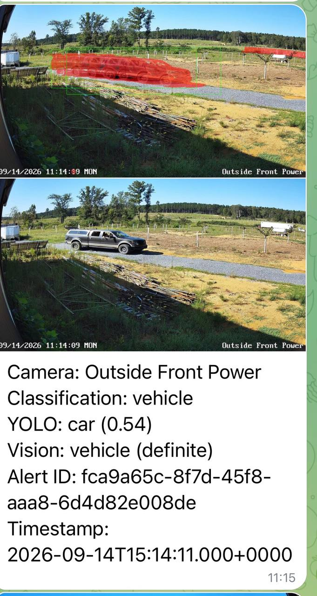
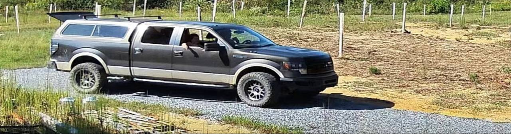
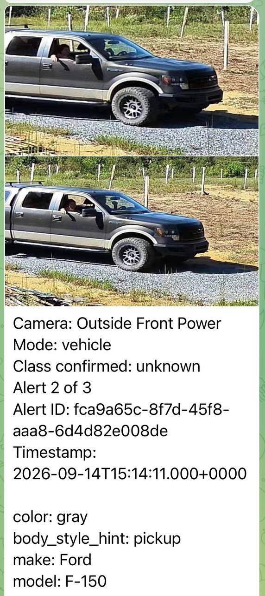
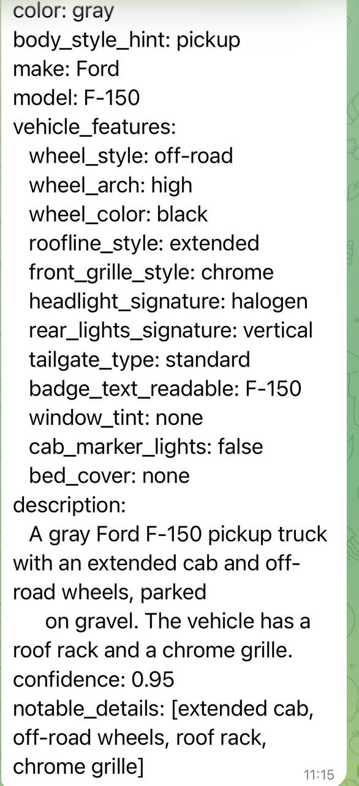
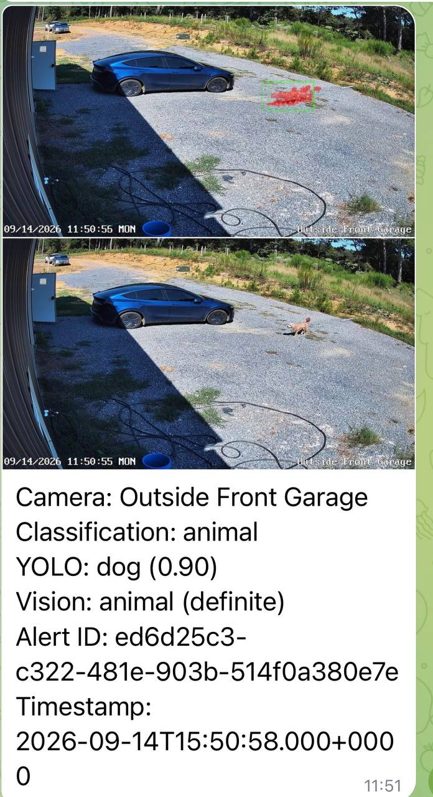
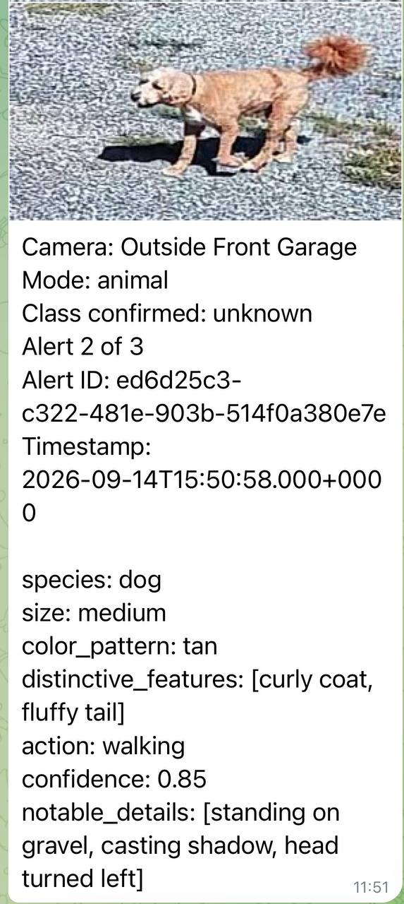

# farm-surveillance-v2

Most consumer IP-camera systems treat every motion alert as worth showing
you. They flood Telegram with branches moving in the wind, headlights
sweeping across a driveway, IR glare flickering off a fence. The result
is the same as no notification at all: you silence the channel.

**farm-surveillance-v2** is the opposite. It runs a small vision pipeline
on each motion event — a YOLO first-pass gate to filter obvious noise, a
locally-hosted vision-LLM (Qwen3-VL) to verify the subject and pull
structured attributes (color, body, make/model, breed, count,
face-visible), a per-camera cooldown, and a motion-aware crop so only the
**moving** subject ends up in the alert, not every vehicle visible in
frame. Per-camera confidence thresholds let you tune a windy porch camera
to demand 0.85 before an alert fires while a quiet driveway camera alerts
at 0.50. Everything runs on your own hardware: no cloud inference, no
vendor subscription, no third party sees your footage.

The payoff is up to three Telegram messages per event — a wide-frame
alert with the motion box, a close-up cropped to just the moving subject,
and (if recognized) a structured match. The crop earns its keep: it's
the difference between "a dog crossed the driveway" and "a small fluffy
dog crossed the driveway, here is just the dog."

## Quick start

```bash
git clone https://github.com/blockops1/ai_camera_monitor.git
cd ai_camera_monitor
python3.11 -m venv .venv && .venv/bin/pip install -e .

# verify the pinned YOLO weights (see "Model weights")
curl -sSL -o models/yolov8n.onnx \
  https://github.com/ultralytics/assets/releases/download/v8.4.0/yolov8n.onnx
shasum -a 256 models/yolov8n.onnx   # must match the pinned hash

# credentials: copy templates, fill in real values, keep out of git (mode 600)
cp camera-creds.env.example camera-creds.env
cp telegram-creds.env.example telegram-creds.env
cp llm-creds.env.example llm-creds.env
cp .env.example .env                    # tunables; farm lat/lon required

# point each camera's webhook at the daemon (see "Reolink camera setup")
#   http://<daemon-host>:8090/alert

# run it
.venv/bin/python -m listener.daemon
```

Trigger a motion event on a camera — a Telegram alert should land within
5–10 seconds. If nothing arrives, check `logs/daemon.log` for connection
errors against the camera IP.

## Requirements

- **Cameras:** Reolink IP cameras (firmware v3.0.0+) that POST motion
  webhooks and expose RTSP; runs over LAN, headless
- **Host:** macOS (launchd-supervised daemon; single Python 3.11
  process). Linux ports are possible but unsupported so far.
- **Vision LLM (optional but recommended):** any local OpenAI-compatible
  Qwen3-VL server (llama.cpp, vLLM, …) — the pipeline degrades to
  YOLO-gate-only without it
- **Telegram bot** for notifications
- ~1 GB RAM overhead + a few GB disk for frame artifacts

## What it does

1. Listens on `:8090/alert` for Reolink motion webhooks (IP-validated,
   rate-limited per source IP)
2. Captures 4 frames around the motion event from a continuous per-camera
   RTSP ring buffer (12-frame lossless PNG ring per camera)
3. Runs a YOLO gate to filter noise vs real subjects
4. Verifies subject class via vision-LLM
5. Asks the vision-LLM for class-specific detail (color, body,
   make/model, breed, count, face-visible, subclass, notes)
6. Looks the subject up against the enrolled matchers
   (animal/person/vehicle) and re-IDs returning subjects via Tier-2 cosine
7. Sends up to three Telegram notifications: alert, detail, optional match
8. Throttles per-`(camera, classification)` to avoid alert storms
9. Exposes a read-only MCP harness + HTTP API for programmatic access
10. Runs a daily status report job that posts an HTML report to a
    Telegram chat

## What alerts look like

Example: a dark gray Ford F-150 driving down the gravel driveway.

| 1. Alert + motion box (wide frame) | 2. Cropped subject |
|---|---|
|  |  |
| Two-frame stack from the camera. Red box = where motion was detected. | Same event, cropped to just the moving vehicle. |

| 3. Closer crop (second angle) | 4. Recognized subject + attributes |
|---|---|
|  |  |
| Closer view of the same vehicle as it passes. | Vision-LLM structured output: color, body style, make, model. |

The crop is the part of the pipeline that earns its keep: when multiple
vehicles are visible in the wide frame (parked + moving), the crop
selector only sends the **moving** one to Telegram, not every vehicle
in frame. Same for animals — the pipeline crops to the animal, not the
whole scene.

Example: a small fluffy dog crossing the gravel.

| Wide frame + motion box | Cropped detail |
|---|---|
|  |  |
| Same two-frame pattern; motion box over the dog. | Vision-LLM cropped to just the dog. |

Telegram format and alert wording are documented in
[`telegram_formatter/`](telegram_formatter/).

## Architecture overview

The full architecture is documented as four hand-authored SVG-in-dark-HTML
diagrams in [`docs/architecture/`](docs/architecture/). Each can be opened
directly in any browser (no build step, no JS, no external assets).

| Diagram | What's in it |
|---|---|
| [`system-architecture.html`](docs/architecture/system-architecture.html) | External actors (Reolink cams, vision-LLM, Telegram, MCP/API clients) → host daemon (3 ports) → 9-stage alert pipeline + side surfaces + filesystem + credential boxes |
| [`pipeline-data-flow.html`](docs/architecture/pipeline-data-flow.html) | Per-event data path: webhook → ring buffer pull → cooldown → YOLO gate → VM1 verify_class → VM2 detail_class → matchers → Telegram formatter → transport |
| [`module-component-map.html`](docs/architecture/module-component-map.html) | Package layout (`infra/`, `listener/`, `vehicle_matcher/`, `animal_matcher/`, `person_matcher/`, `telegram_formatter/`) with import-direction arrows |
| [`deployment-topology.html`](docs/architecture/deployment-topology.html) | 4 zones: LAN cams → Reolink gateway → Tailscale → daemon host, with cross-zone traffic summary and privacy-boundary callouts |

Quick mental model:

```
Reolink cam ─▶ /alert :8090 (LAN only, IP-validated)
                       │
                       ▼
        listener/daemon.py  (single Python process, 3 socket bindings)
              ├── :8090 webhook (LAN, alerts in)
              ├── :8091 MCP server (Tailscale, 18 read-only tools)
              └── :8092 HTTP API  (Tailscale, 17 GETs + /healthz)
                       │
                       ▼
   9-stage alert pipeline  (linear, single-threaded, sync)
     1. webhook receiver → 2. ring pull → 3. cooldown
     4. YOLO gate → 5. vision-LLM verify → 6. vision-LLM detail
     7. matcher (vehicle / animal / person, Tier-2 cosine)
     8. Telegram formatter (tg1, tg2, tg3) → 9. transport
```

Side surfaces (read-only, do not affect pipeline):

- `infra/mcp_server.py` — 18 MCP tools at `:8091` (Tailscale)
- `infra/api_server.py` — `/api/v1/*` at `:8092` (Tailscale)
- `infra/daily_status_report.py` — HTML once/day, posted to TG
- `bin/health_watchdog.sh` — liveness + disk + webhook-rate check

For ASCII-only fallback see
[`docs/ARCHITECTURE-alert-pipeline-2026-09-27.md`](docs/ARCHITECTURE-alert-pipeline-2026-09-27.md)
(stage-by-stage prose).

## Reolink camera setup

Each camera must be wired up twice: once on the camera's web UI (motion
alerts enabled, webhook URL configured, framerate set), and once in
`camera-creds.env` so the daemon can validate incoming requests and pull
frames from the camera's RTSP stream.

This section is a working overview. Model-specific quirks (RLC-510A
vs RLC-833A, firmware differences) live in operator playbooks — this
README covers what works on modern firmware across both.

### 1. Enable push notifications on the camera

Open the camera's web UI (`http://<camera-ip>/`, log in with admin
credentials). On Reolink models with firmware v3.0.0+:

- Click the **gear icon** (top-right). On some models, only a
  center-click on the gear opens the full settings panel — a click
  on the icon's edge may open a stripped-down view that hides the
  Push and webhook controls.
- Click **Surveillance → Push**.
- Toggle **Push Notifications** ON.

If your camera runs older firmware, this toggle may not appear in
the gear panel — use the Reolink mobile or desktop app to enable
push notifications per camera.

### 2. Configure the webhook URL

On the same Push page, scroll to **For Developer → Webhook**:

- Click **Add**.
- Enter the webhook URL: `http://<daemon-host>:8090/alert`
  (default daemon port is `8090`; override with `LISTEN_PORT`).
- Save.

The URL must be reachable from the camera's network. If the camera
is on `192.168.1.x` and the daemon is on a separate machine,
configure port forwarding or run the daemon on the camera's subnet.

### 3. Set framerate

Lower framerate = less RTSP bandwidth + lower motion-detection load.
Set the **main stream** to **2–6 fps**: 2 fps is sufficient for
vehicle/person detection and halves bandwidth vs 6 fps; 6 fps is a safe
upper starting point.

The easiest path is the camera's web UI under
Settings → Stream → Encode (or via the CGI `SetEnc` endpoint on
supported firmware). Note: on RLC-510A v3.2.0+, only even fps values
are accepted (`[2, 4, 6, 8, 10, 12]`) — odd values return a
`param error`.

### 4. Wire the camera into camera-creds.env

The daemon rejects webhook requests from unknown camera IPs.
Add one stanza per camera to `camera-creds.env` (mode 600, never
committed). Template:

```bash
# Front door camera
FRONT_IP=192.0.2.10  # example LAN address; use your camera's actual IP
FRONT_HTTP_USER=admin
FRONT_HTTP_PASS=<from-camera-web-ui>
FRONT_RTSP_USER=admin
FRONT_RTSP_PASS=<from-camera-web-ui>
FRONT_RTSP_URL=rtsp://${FRONT_RTSP_USER}:${FRONT_RTSP_PASS}@${FRONT_IP}:554/Preview_01_main
```

`camera-creds.env.example` at the repo root is the template. Copy it,
fill in real values, mode 600, never commit.

Verify each stanza is reachable: `curl -s -o /dev/null -w "%{http_code}\n"
-u <HTTP_USER>:<HTTP_PASS> http://<camera-ip>/cgi-bin/api.cgi?cmd=GetDevInfo`
should return `200`. If you get `401`, the HTTP user/pass in
`camera-creds.env` doesn't match the camera's actual credentials.

### 5. Restart and verify

After all four steps are wired, bounce the daemon (see
[Daemon management](#daemon-management) below) and trigger a test
motion event on the camera. The pipeline should deliver a Telegram
alert within 5-10 seconds. If nothing arrives, check
`logs/daemon.log` for connection errors against the camera IP.

## MCP harness

`infra/mcp_server.py` exposes 18 read-only tools over the Model Context
Protocol. The harness is **strictly read-only** — write tools (camera
config, recipe apply, person/animal enrollment beyond `enroll_person`)
ship in a later release. Tailscale-bound by default
(`FARMSURV_MCP_BIND=tailnet-only`).

Token auth via `FARMSURV_MCP_TOKEN` (32+ chars; same
`secrets.token_urlsafe(32)` recipe as the API token). Configure once
in `.env` or `~/.env`; the client supplies it as
`Authorization: Bearer <token>`.

| Tool | What it returns |
|---|---|
| `list_cameras` | CameraInfo for all configured cams (alias, label, model, redacted RTSP URL) |
| `get_camera_health` | `CameraHealth` for one cam (online, last_frame_at, rtsp_errors_last_24h) |
| `get_camera_snapshot` | Latest cached frame path (no live pull) |
| `get_live_snapshot` | One-shot JPEG pull from the camera (useful for "what does the porch look like right now?") |
| `list_events` | Recent webhook events (paginated) |
| `get_event` | One event with full pipeline trace |
| `get_gate_config` | Per-camera gate thresholds (subjects, vehicle/person confidence floors, motion gate) |
| `list_suppression_rules` | Active suppression rules (night-suppress, baseline-override, global-change-max-pct) |
| `list_active_cooldowns` | Per-(cam, classification) cooldowns in effect |
| `list_known_people` | Enrolled person identities |
| `list_known_vehicles` | Enrolled vehicle identities |
| `list_known_animals` | Enrolled animal identities |
| `enroll_person` | Enroll a new person (writes to `data/known/people/`) |
| `get_listener_status` | Listener health: PID, uptime, ports, alerts/min, mcp_enabled |
| `get_recent_errors` | Last N daemon.log ERROR lines |
| `get_vision_status` | Vision-LLM endpoint health, model load state, request count |
| `get_telegram_status` | Telegram bot health, last-send timestamp, rate-limit headroom |
| `get_config` | Operator-configured env vars (no secrets — token values redacted) |

Live smoke test: `bin/mcp_live_smoke.sh`.

## API server

`infra/api_server.py` exposes the same read-only surfaces as a
plain JSON HTTP API. Tailscale-bound by default
(`FARMSURV_API_BIND=tailnet-only`); token auth via `FARMSURV_API_TOKEN`.

Runs as a thread inside the listener process by default; can be run
standalone with `python -m infra.api_server` for diagnostics. Mirror
mapping (MCP tool → API path):

| MCP tool | API path |
|---|---|
| `list_cameras` | `GET /api/v1/cameras` |
| `get_camera_health` | `GET /api/v1/cameras/{id}/health` |
| `get_camera_snapshot` | `GET /api/v1/cameras/{id}/snapshot` |
| `get_live_snapshot` | `GET /api/v1/cameras/{id}/live_snapshot` |
| `list_events` | `GET /api/v1/events?limit=N&since=ISO8601` |
| `get_event` | `GET /api/v1/events/{id}` |
| `get_gate_config` | `GET /api/v1/gate` |
| `list_suppression_rules` | `GET /api/v1/gate/suppression-rules` |
| `list_active_cooldowns` | `GET /api/v1/cooldowns` |
| `list_known_people` | `GET /api/v1/identities/people` |
| `list_known_vehicles` | `GET /api/v1/identities/vehicles` |
| `list_known_animals` | `GET /api/v1/identities/animals` |
| `get_listener_status` | `GET /api/v1/listener/status` |
| `get_recent_errors` | `GET /api/v1/listener/errors` |
| `get_vision_status` | `GET /api/v1/vision/status` |
| `get_telegram_status` | `GET /api/v1/telegram/status` |
| `get_config` | `GET /api/v1/config` |

Each response is wrapped: `{"box_id": "...", "data": {...}}` (list
endpoints) or `{"box_id": "...", "data": {...}, "next_page_token": "..."}`
(paginated list endpoints). LAN IPs in any string field are
auto-redacted to `[REDACTED-LAN-IP]` (192.168.x.x only — see
`infra/farm_api/cameras._redact_ip`).

Health probe: `GET /healthz` returns
`{"status": "healthy", "pid": N, "uptime_seconds": N, ...}`.

Live smoke test: `bin/api_live_smoke.sh`.

## Daily status report

`infra/daily_status_report.py` runs once a day under launchd
(operator template plist: `bin/com.farm.surveillance.v2.smoke.plist`).
Generates an HTML report covering:

- Listener health (PID, uptime, port status)
- Per-camera RTSP connection count + CPU + main-stream encode
- Pipeline funnel: webhooks received → gate-passed → VM1 evaluated →
  VM2 enriched → alerts sent, over a rotation-aware 24 h window
- Error count + recent error lines
- Disk free space + daemon.log size
- Crop + frame artifact retention cap

The HTML is saved under `logs/daily-status/` and posted to a Telegram
chat as a document via `TELEGRAM_BOT_TOKEN` + `TELEGRAM_HOME_CHAT_ID`.
Pure-function design: `build_report()` → `render_html()` →
`save_report()` → `send_document()`, each independently testable.

## Privacy guard

The project ships 4 pre-push scanners that run on every push to the
public github remote. All 4 must exit 0 for the push to succeed.

| Scanner | Catches | File |
|---|---|---|
| `check_no_private_data` | Tracked `.env`, `*-creds.env`, and any LAN IP literal in the scanner's regex range (192.168.[1-9].1[0-9]{2}) | `scripts/check_no_private_data.py` |
| `check_no_jpeg` | JPEG references in production source code (ring buffer is PNG-only; jpeg only allowed in the vision-LLM client for the live-snapshot response) | `scripts/check_no_jpeg.py` |
| `check_no_image_resize` | Image-resize calls in production source (we use bbox-based cropping, never Pillow resize — that's lossy) | `scripts/check_no_image_resize.py` |
| `check_no_orphan_modules` | Production modules with no caller (catches the dead-code class of failure) | `scripts/check_no_orphan_modules.py` |

A fifth guard, `check_no_secrets_in_history.py`, runs as a pre-push
history check so secrets never reach the remote even in older commits.

Two-tier exclusion: `_KNOWN_FP` (line number, for one-off exclusions)
and `_KNOWN_FP_BY_FUNCTION` (function name, durable across line drift
when the source is edited).

Plus `scripts/release/config.yaml` `strip_paths` (defense in depth):
the public-cut pipeline strips `*.env` files even if they somehow get
tracked. **The scanner is the primary defense** — `strip_paths` is
the backup.

Run all scanners locally before pushing to github: `make check-privacy`.

**Scanner coverage note**: the IP scanner is intentionally narrow so it
doesn't flag documentation placeholders like `192.168.1.1`. It does not
catch every IP form — the logic is open source
(`scripts/check_no_private_data.py`); grep your own docs and fixtures for
real addresses before publishing anything.
- Anything outside `192.168.*.*` (e.g. `10.0.0.x`, RFC 5737) — not a
  leak; standard RFC 1918 / documentation ranges.

## RTSP robustness

Each camera has its own RTSP reader with two layers of recovery:

| Mechanism | Cadence | What it does |
|---|---|---|
| Scheduled reconnect | every `FARMSV_RTSP_RECONNECT_SECONDS` (default 3600s) | proactive close + respawn of the RTSP stream |
| Reconnect attempt cap | after `FARMSV_RTSP_MAX_RETRIES` (default 10) consecutive failures | back off and let the scheduled reconnect take over |

Together these prevent two failure modes: silent decoder stalls
(triggered when no frames arrive for too long) and infinite reconnect
loops when a camera is genuinely offline.

The per-camera ring buffer is **12 frames** (down from 180 in v0.6.x;
the wider buffer wasn't being used and ate disk on high-traffic
cameras). Lossless PNG. Alert frames are pulled from ring slots
`[-5,-4,-2,-1]` plus one final grab after a 0.5 s delay, chosen so the
4 images bracket a subject's approach at typical pipeline latency
(~4 s at 2 fps camera settings).

## Diagnostics

- `GET /api/v1/listener/status` — PID, uptime, port status,
  alerts/min, mcp_enabled, env_var count (live via Tailscale)
- `GET /api/v1/listener/errors?limit=N` — last N daemon.log ERROR lines
- `GET /api/v1/cameras` — per-cam `CameraInfo` (alias, label, model,
  redacted RTSP URL)
- `GET /api/v1/cameras/{id}/health` — `CameraHealth` (online,
  last_frame_at, rtsp_errors_last_24h)
- `GET /api/v1/cameras/{id}/live_snapshot` — one-shot JPEG pull
- `bin/health_watchdog.sh` — listener liveness + disk space +
  webhook-receipt cadence. Silent when healthy; alerts on failure.
- Unified log: `logs/daemon.log` (single stream, daemon writes here;
  size-capped rotation keeps the last ~8 MB)
- Daily report: `logs/daily-status/*.html` (one per day, sent to Telegram)

## Layout

```
infra/                   # shared modules: gate, frame_capture, cooldown, schemas
  api_server.py          # HTTP read-only API (Tailscale-bound)
  mcp_server.py          # MCP read-only tools (Tailscale-bound)
  daily_status_report.py # HTML report builder + Telegram send
  camera_creds.py        # per-cam IP / user / pass resolver
  net_bind.py            # tailnet vs all bind helpers
  farm_api/              # per-resource read-only API modules (cameras, events, gate, …)
listener/                # webhook receiver + linear pipeline + health
vehicle_matcher/         # re-ID for returning vehicles (cosine Tier-2)
animal_matcher/          # re-ID for returning animals (cosine Tier-2)
person_matcher/          # re-ID for returning people (cosine Tier-2, scaffolding)
telegram_formatter/      # Telegram stage formatters (alert, detail, match)
scripts/                 # operator scripts: enroll_*, smoke_*, watchdog, scanners
  backtests/             # prompt + motion backtest scripts (moved from infra/)
bin/                     # shell helpers + plist templates
config/                  # motion_gate_thresholds.json, camera_recipes.toml
docs/                    # PLAN.md, architecture diagrams, PRD JSONs
tests/                   # pytest
camera-creds.env.example # template for camera credentials
telegram-creds.env.example # template for Telegram credentials
llm-creds.env.example    # template for vision-LLM endpoint
```

## Configuration

Env files are mode 600 and **never committed**. Daemon reads them at
boot from these locations, last-write-wins per key:

| File | What | Loaded by |
|---|---|---|
| `camera-creds.env` (repo root) | per-camera IP / HTTP user+pass / RTSP user+pass+url | `infra/camera_creds.py` |
| `telegram-creds.env` (repo root) | Telegram bot token + chat ID | `listener/daemon.py` |
| `llm-creds.env` (repo root) | vision-LLM endpoint + auth | `infra/vision_analyzer.py` |
| `~/.env` (user home) | runtime flags (see `.env.example`) | `listener/daemon.py` |

`*.env.example` files at the repo root are the templates. Copy, fill
in real values, mode 600, never commit.

Public-facing env vars (no secrets; values shown in `.env.example`):

| Var | Default | Purpose |
|---|---|---|
| `LISTEN_HOST` | `0.0.0.0` | webhook bind |
| `LISTEN_PORT` | `8090` | webhook bind |
| `VISION_LLM_URL` | `http://127.0.0.1:8000` | vision-LLM endpoint |
| `LOG_LEVEL` | `INFO` | log level |
| `DISPLAY_TZ` | `America/New_York` | Telegram timestamp TZ (IANA name) |
| `FARMSV_RTSP_RECONNECT_SECONDS` | `3600` | scheduled RTSP reconnect cadence |
| `FARMSV_RTSP_MAX_RETRIES` | `10` | reconnect attempt cap before deferring |
| `FARMSURV_MCP_ENABLED` | `0` | MCP harness (1=ON, 0=OFF) |
| `FARMSURV_MCP_BIND` | `tailnet-only` | MCP bind (tailnet-only / all / interface) |
| `FARMSURV_MCP_PORT` | `8091` | MCP port |
| `FARMSURV_MCP_TOKEN` | (required) | MCP bearer token (32+ chars) |
| `FARMSURV_API_ENABLED` | `0` | HTTP API (1=ON, 0=OFF) |
| `FARMSURV_API_BIND` | `tailnet-only` | API bind (tailnet-only / all / interface) |
| `FARMSURV_API_PORT` | `8092` | API port |
| `FARMSURV_API_TOKEN` | (required) | API bearer token (32+ chars) |
| `FARMSURV_BOX_ID` | `''` | box identifier in API responses |
| `FARMSURV_TG_RATE_LIMIT_PER_MIN` | `30` | Telegram bot API rate-limit guard |
| `FARMSURV_FARM_LAT` | **(required)** | suntime twilight calc — set to your property's latitude |
| `FARMSURV_FARM_LON` | **(required)** | suntime twilight calc — set to your property's longitude |
| `FARMSURV_NIGHT_TWILIGHT_BUFFER_MIN` | `0` | night-window buffer (minutes) |
| `MOTION_GATE_NIGHT_SUPPRESS_ENABLED` | `1` | night motion-gate suppression (1=ON, 0=OFF) |
| `FARMSURV_QUIET_HOURS_ENABLED` | `0` | quiet-hours Telegram suppression (1=ON, 0=OFF) |
| `FARMSURV_BASELINE_OVERRIDE_ENABLED` | `0` | distant-vehicle threat demotion (1=ON, 0=OFF) |
| `FARMSURV_GLOBAL_CHANGE_MAX_PCT` | `60` | suppress if motion bbox > N% of frame area |
| `FARMSURV_NIGHT_VEHICLE_CORROBORATION` | `0` | night headlight/flare false-positive gate (1=ON, 0=OFF) |
| `FARMSURV_CROP_EXT` | `0` | vertical extension factor for person-class crops (0=off) |

Boolean env vars: **write what each value does, not just the variable.**
Every `=0`/`=1` declaration in `.env.example` has an inline comment
showing what each value does. Established convention: `1 = ON, 0 = OFF`.

Per-camera tunables live in `config/motion_gate_thresholds.json`
(`subjects`, `vehicle_confidence_floor`, `person_confidence_floor`,
`gate_enabled`). In `subjects`, `"animal"` expands to all COCO animal
classes (dog, cat, sheep, cow, bear, bird, …), so one keyword covers
wildlife and livestock. Per-camera recipe (vision-LLM prompt adjustments
and re-ID threshold) lives in `config/camera_recipes.toml`.

**Config changes require a daemon restart** — thresholds are cached at
process start; edits to the JSON do not hot-reload.

## Security notes

**API_BIND=all binds 0.0.0.0 — bearer token travels over PLAINTEXT HTTP.**
When `FARMSURV_API_BIND=all`, the API server listens on every interface at
`0.0.0.0:8092`. Requests are **unencrypted HTTP** — the bearer token is sent
in plaintext. This is safe on a trusted Tailscale CGNAT (100.64.0.0/10) where
all traffic is encrypted by the Tailscale overlay, but **dangerous on any
other network** (home LAN, public Wi-Fi, cellular). The default
`FARMSURV_API_BIND=tailnet-only` is the safe mode. If you use `all`, ensure
your network is trusted and consider deploying a TLS reverse proxy.

Same applies to `FARMSURV_MCP_BIND=all` for the MCP server on port 8091.

**Farm coordinates are required in .env.** The code ships no hardcoded
lat/lon defaults that geolocate a property in the public repo. Set
`FARMSURV_FARM_LAT` and `FARMSURV_FARM_LON` in your `.env` file (see
`.env.example` for the template). The daemon refuses to start without these
values set.

## Daemon management

The daemon runs under launchd as `com.farm.surveillance.v2`. Plist:
`~/Library/LaunchAgents/com.farm.surveillance.v2.plist`.

```bash
# view status
launchctl list | grep com.farm.surveillance.v2
tail -f logs/daemon.log

# bounce
launchctl bootout gui/$(id -u) ~/Library/LaunchAgents/com.farm.surveillance.v2.plist
launchctl bootstrap gui/$(id -u) ~/Library/LaunchAgents/com.farm.surveillance.v2.plist
```

`KeepAlive: true` in the plist means launchd respawns automatically on
exit. The plist does **not** carry Telegram credentials — those load
from `~/.env` at boot.

The daily status report runs as a separate launchd job
(`com.farm.surveillance.v2.smoke`, plist template in `bin/`).

## Development

Requires Python 3.11. Setup:

```bash
./.venv/bin/python3.11 -m pip install -e .
./.venv/bin/python3.11 -m pytest tests/ -x --tb=short
```

The test suite covers:

- `/alert` route (IP validation, payload shape, motion gate hookup)
- Per-camera RTSP reader lifecycle (mock container, advance time)
- Decoder failure handling (always-raise mock decoder)
- Crop selector and trajectory extraction
- Telegram formatting stages
- `farm_api.*` read paths (cameras, events, gate, identities, listener status)
- `mcp_server` tool dispatch (mock client, 18 tools)
- Privacy scanners (`check_no_private_data`, `check_no_jpeg`,
  `check_no_image_resize`, `check_no_orphan_modules`)
- Daily status report (`build_report` → `render_html` → `save_report`)
- Animal/person/vehicle matcher (Tier-2 cosine on mock embeddings)

**Test fixture pattern:** tests resolve cam IPs from env vars with
RFC 1918 placeholder defaults — never hardcode production cam IPs.
Use `os.environ.get("FARM_TEST_FRONT_IP", "192.168.1.1")` for tests
that need to assert on `_redact_ip` behavior (the production redaction
only matches `192.168.*.*`); use `10.0.0.*` or `[REDACTED-LAN-IP]`
for tests that don't.

**Mock-hygiene rule:** the pytest suite maintains a genuine green gate
(850+ tests). End-to-end tests run against real HTTP
(`httpx.MockTransport` is un-mocked for them); any new autouse mock must
restore the real object at teardown, not whatever `httpx.Client` happens
to be at that moment. A silently mocked e2e suite asserts nothing.

Pre-push before opening a PR:

```bash
make check-privacy   # scanners + cred-guard
```

## Model weights

The YOLOv8n ONNX model (COCO, ~12 MB) is downloaded from the official
ultralytics v8.4.0 release:

```bash
curl -sSL -o models/yolov8n.onnx \
  https://github.com/ultralytics/assets/releases/download/v8.4.0/yolov8n.onnx
```

Expected SHA256:
`b2bc52f40e8e1c532427d5bde3575a5d5b571b739fab2c6df443733ed1589cbd`

Verify after download:

```bash
shasum -a 256 models/yolov8n.onnx
```

If the hash does not match, the file is corrupt or tampered with. Do not
proceed.

**Operator-fine-tuned exports** (e.g. `scripts/export_yolo_dynamic.py`)
produce a different binary with a different SHA256. When loading one of
those, set the env var `FARMSURV_YOLO_ALLOW_EXTRA_SHA=<your-sha256-hex>`
so the classifier accepts it. Without that env var the classifier refuses
to load a model whose hash does not match the official pin.

## Changelog

### v0.7.3 (2026-10-30)

Alert-quality and operator-reporting release:

- **Alert capture window retuned against live footage** — the 4 alert
  images now come from ring slots `[-5,-4,-2,-1]` plus a final grab
  after 0.5 s, bracketing a subject's approach at 2 fps camera
  settings and typical pipeline latency.
- **Animals alert on every camera** — `"animal"` in
  `motion_gate_thresholds.json` now expands to all COCO animal classes
  (dog, cat, sheep, cow, bear, bird, …) instead of matching nothing;
  animals enabled on all perimeter cameras.
- **Night-time suppression** — night vehicle corroboration gate
  (headlight/flare false positives, env-gated) and night `no_class`
  rescue via VM1.
- **Crop improvements** — vertical person-crop extension
  (`FARMSURV_CROP_EXT`), per-camera `DIFF_THRESHOLD` override, OSD
  region masking + per-camera ROI exclusion zones (timestamp/banner
  motion no longer counts as subject motion).
- **Daily status report** — adds a pipeline funnel (webhooks →
  gate-passed → VM1-evaluated → VM2-enriched → alerts sent), fixes
  webhook undercount after log rotation, honest frames column;
  `daemon.log` gets size-capped rotation.
- **Vision backend** — pinned model name for the local
  OpenAI-compatible vision server; background LLM path supported.
- **Privacy / security** — farm coordinates moved to required `.env`
  vars (no hardcoded geolocation in the repo), `API_BIND=all`
  plaintext warning, YOLO weights pinned to the official URL with
  SHA256 verification, history-level secret scanner + pre-push
  history guard, public-tree metadata sanitization.
- **Quality gate integrity** — fixed a cross-file mock leak that left
  31 end-to-end tests asserting against MagicMocks (the release pytest
  gate had been silently red). Full suite now genuinely green:
  858 passed / 28 skipped.
- **MCP spec fix** — JSON-RPC notifications return 202.

Run `git log v0.7.2..v0.7.3 --oneline` for the full commit list.

### v0.7.2 (2026-10-17)

- RTSP steady-state reliability: in-thread periodic stream teardown in
  the decode loop (replaces the watchdog thread), plist `KeepAlive`
  value read from disk instead of assumed.
- Daily status report: 24 h history section + current-state bug fixes.
- `enroll_person` image paths chrooted under `FARMSURV_DATA_DIR`.

### v0.7.1 (2026-10-15)

- Patch: lint cleanup + enroll-path fix.

### v0.7.0 (2026-10-15)

Major API + matcher release (~240 commits since v0.6.3):

- **MCP harness** — 18 read-only tools (`list_cameras`, `get_event`,
  `get_gate_config`, identities, `get_live_snapshot`, …) with bearer
  token auth, Tailscale-bound.
- **HTTP API server** — read-only `/api/v1/*` mirroring the MCP tools;
  responses auto-redact LAN IPs.
- **Daily status report job** — HTML report posted to Telegram once a
  day (listener health, per-cam state, webhook counts, errors, disk).
- **Privacy guard** — pre-push scanners + `make check-privacy`.
- **Animal matcher (Tier-2 cosine)** — re-ID of returning animals
  (cats, dogs) across days.
- **Person embedder + enroll_person** — OSNet body+face embedding
  scaffolding for person re-ID.
- **Vision schema v2** — every alert carries `face_visible`, `count`,
  `subclass`, and `notes` alongside the legacy attribute tuple.
- **Health watchdog** — liveness, disk space, webhook-receipt cadence;
  silent when healthy, alerts on failure.
- **Telegram rate-limit guard** — `FARMSURV_TG_RATE_LIMIT_PER_MIN`
  (default 30).
- **Ring buffer slimmed** 180 → 12 frames (lossless PNG).
- **4 architecture diagrams** — hand-authored SVG-in-dark-HTML in
  `docs/architecture/`; open in any browser, no build step.

Run `git log v0.6.3..v0.7.0 --oneline` for the full commit list.

## License

This project is licensed under the MIT License — see [`LICENSE`](LICENSE).
