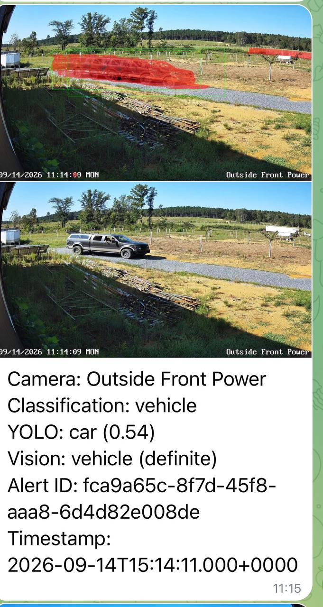
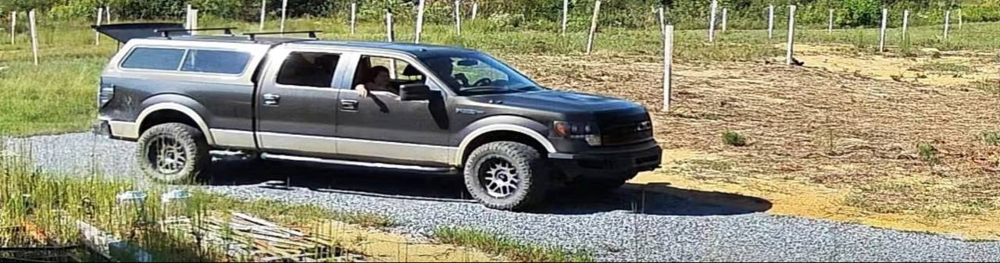
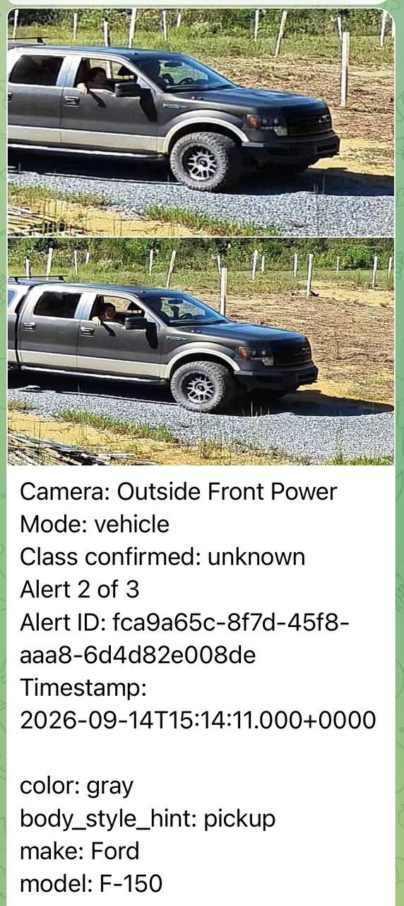
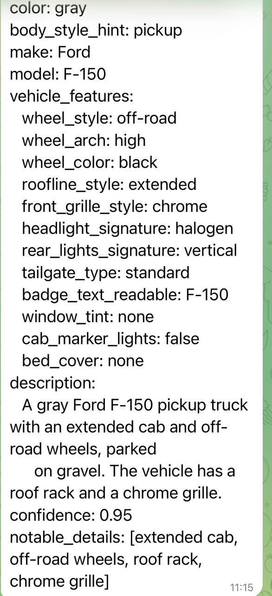
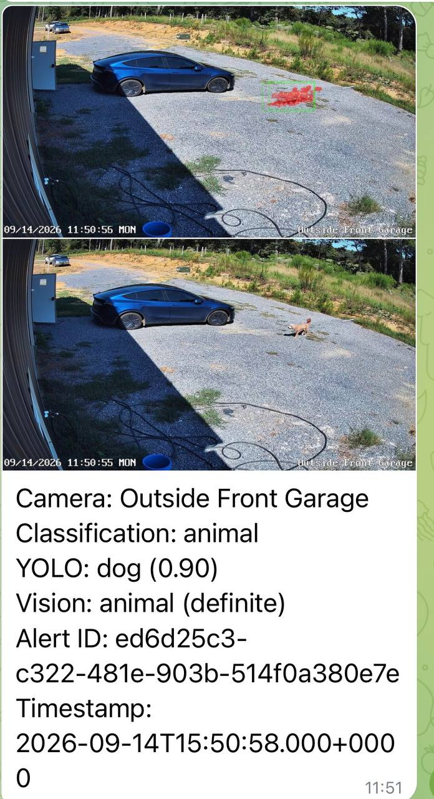
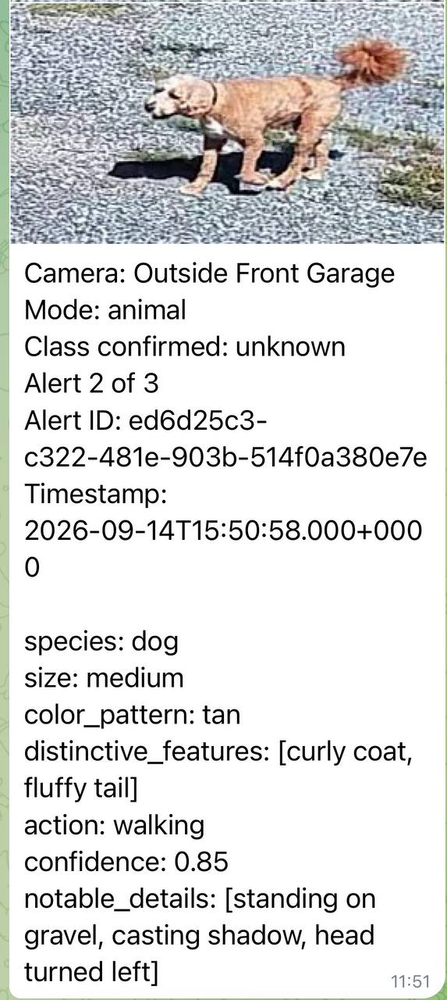

# farm-surveillance-v2

Most consumer IP-camera systems treat every motion alert as worth showing
you. They flood Telegram with branches moving in the wind, headlights
sweeping across a driveway, IR glare flickering off a fence. The result
is the same as no notification at all: you silence the channel.

**farm-surveillance-v2** is the opposite. It runs a small vision pipeline
on each motion event — a YOLO first-pass gate to filter obvious noise, a
vision-LLM (Qwen3-VL) to verify the subject and pull structured attributes
(color, body, make/model, breed, count, face-visible), a per-camera
cooldown, and a motion-aware crop so only the **moving** subject ends up
in the alert, not every vehicle visible in frame. Per-camera confidence
thresholds let you tune a windy porch camera to demand 0.85 before an
alert fires while a quiet driveway camera alerts at 0.50.

The pipeline delivers up to three Telegram messages per event: a
wide-frame alert with the motion box, a cropped close-up of just the
moving subject, and (if recognized) a structured match result. The crop
is the part that earns its keep — it's the difference between "a dog
crossed the driveway" and "a small fluffy dog crossed the driveway, here
is just the dog."

Built for Reolink IP cameras; runs as a single Python daemon under
`launchd` on macOS. Phase PRDs in [`docs/`](docs/).

## What's new in v0.7.0 (2026-10-14)

240 commits since v0.6.3. Major additions in this release:

- **MCP harness** — 18 read-only tools at `infra/mcp_server.py` for
  programmatic access to cameras, events, gate config, suppression rules,
  cooldowns, identities (people/vehicles/animals), listener status,
  recent errors, vision + Telegram status, and `get_live_snapshot` (a
  one-shot JPEG pull from a camera, useful for "what does the porch
  look like right now?"). Token auth via `FARMSURV_MCP_TOKEN`.
- **HTTP API server** — read-only `infra/api_server.py` exposing
  `/api/v1/cameras`, `/api/v1/events`, `/api/v1/gate/*`,
  `/api/v1/identities/*`, `/api/v1/listener/status`, plus
  `get_live_snapshot` mirroring the MCP tool 1:1. Token auth via
  `FARMSURV_API_TOKEN`. Binds Tailscale-only by default.
- **Daily status report cron** — `infra/daily_status_report.py` runs
  once a day under launchd, generates an HTML report covering listener
  health, per-cam RTSP / CPU / encode state, webhook counts, errors, and
  disk usage, then sends it to a Telegram chat as a document. Plist
  template: `bin/com.farm.surveillance.v2.smoke.plist`.
- **Privacy guard** — 4 pre-push scanners
  (`scripts/check_no_private_data.py`, `check_no_jpeg.py`,
  `check_no_image_resize.py`, `check_no_orphan_modules.py`) plus a
  `make check-privacy` target. The pre-push hook runs all of them on
  the public remote (github) and blocks any push that would ship a
  tracked credential file, a private LAN IP that the scanner regex
  catches, a JPEG-in-source-code slip, an image-resize-in-production-
  source slip, or an orphan module (production code with no caller).
  See "Privacy guard" below.
- **Animal matcher (Tier-2 cosine)** — `animal_matcher/match.py` +
  `storage.py` + `infra/animal_embedder.py` + `scripts/enroll_animal.py`
  for re-ID of returning animals (cats, dogs) across days.
- **Person embedder + enroll_person** — `infra/person_embedder.py` +
  `scripts/enroll_person.py` (OSNet body+face embedding scaffolding for
  person re-ID). `person_matcher/` module with the same shape as
  `animal_matcher/`.
- **Vision schema v2** — US-060c/d/e: every alert now carries
  `face_visible`, `count`, `subclass`, and `notes` fields alongside the
  legacy `color/body/make/model/breed` tuple. Drives the structured TG
  match line.
- **`_camera_model` keyed by camera alias** (US-068b1) — internal
  helper that used to look up the camera model by IP is now keyed by
  camera alias (`FRONT`/`BACK`/etc.), so the function no longer depends
  on the operator's LAN layout and works correctly in CI.
- **`CAMS()` resolves cam IPs from `camera-creds.env` at runtime**
  (US-038 follow-up) — `infra/daily_status_report.CAMS` is now a
  function returning cam dicts with IPs filled in from the env file.
  CI shows `[REDACTED-LAN-IP]` for all cams (no env file present);
  production shows the real IPs.
- **Health watchdog** — `bin/health_watchdog.sh` + plist monitoring
  listener liveness, disk space, and webhook-receipt cadence. Silent
  when healthy; alerts on failure.
- **Telegram rate-limit guard** — `infra/telegram_alerts.py` honors
  `FARMSURV_TG_RATE_LIMIT_PER_MIN` (default 30) to prevent bot API
  rate-limit warnings from spamming the operator.
- **File reorganization** — backtest scripts and `watchdog_restart.py`
  moved from `infra/` to `scripts/` (orphans resolved); `env_utils.py`
  and `telegram_formatter/no_match_telegram.py` removed (consolidated).
  `animal_matcher/` and `person_matcher/` are now top-level packages.
- **Test fixture pattern** — tests resolve cam IPs from env vars
  (`FARM_TEST_FRONT_IP` / `FARM_TEST_BACK_IP`) with RFC 1918 placeholder
  defaults, never hardcode production cam IPs. See the "Development"
  section.
- **4 architecture diagrams** — `docs/architecture/` ships hand-authored
  SVG-in-dark-HTML files for system architecture, per-event pipeline
  data flow, module/component map, and deployment topology. Open
  directly in any browser; no build step. Replaces the inline ASCII
  diagram that used to live in this README's "Architecture overview"
  section.

Run `git log v0.6.3..v0.7.0 --oneline` for the full commit list.

## What this is

A small Python service that:

1. Listens on `:8090/alert` for Reolink motion webhooks (IP-validated,
   rate-limited per source IP)
2. Captures 4 frames around the motion event from a continuous per-camera
   RTSP ring buffer (12-frame lossless PNG ring per camera)
3. Runs a YOLO gate to filter noise vs real subjects
4. Verifies subject class via vision-LLM (Qwen3-VL on `:8080`)
5. Asks vision-LLM for class-specific detail (color, body, make/model,
   breed, count, face-visible, subclass, notes)
6. Looks up the subject against the enrolled matcher (animal/person/vehicle)
   and re-ID's returning subjects via Tier-2 cosine
7. Sends three Telegram notifications: alert, detail, optional match
8. Throttles per-`(camera, classification)` to avoid alert storms
9. Exposes a read-only MCP harness + HTTP API for programmatic access
10. Runs a daily status report cron that posts an HTML report to a
    Telegram chat


## What alerts look like

When a camera sends a motion webhook, the pipeline runs end-to-end and
delivers up to three Telegram notifications: an alert with the wide
frame and motion box, a cropped detail image of the moving subject,
and (if the subject is recognized) a structured match result.

Example: a dark gray Ford F-150 driving down the gravel driveway.

| 1. Alert + motion box (wide frame) | 2. Cropped subject |
|---|---|
|  |  |
| Two-frame stack from the camera. Red box = where motion was detected. | Same event, cropped to just the moving vehicle. |

| 3. Closer crop (second angle) | 4. Recognized subject + attributes |
|---|---|
|  |  |
| Closer view of the same vehicle as it passes. | Vision-LLM structured output: color, body style, make, model. |

The crop is the part of the pipeline that earns its keep: when multiple
vehicles are visible in the wide frame (parked + moving), the crop
selector only sends the **moving** one to Telegram, not every vehicle
in frame. Same for animals — the pipeline crops to the animal, not the
whole scene.

Example: a small fluffy dog crossing the gravel.

| Wide frame + motion box | Cropped detail |
|---|---|
|  |  |
| Same two-frame pattern; motion box over the dog. | Vision-LLM cropped to just the dog. |

Telegram format and alert wording are documented in
[`telegram_formatter/`](telegram_formatter/).

## Architecture overview

The full v0.7.0 architecture is documented as four hand-authored SVG-in-dark-HTML diagrams
in [`docs/architecture/`](docs/architecture/). Each can be opened directly in any browser
(no build step, no JS, no external assets).

| Diagram | What's in it |
|---|---|
| [`system-architecture.html`](docs/architecture/system-architecture.html) | External actors (Reolink cams, Qwen3-VL, Telegram, MCP/API clients) → Mac mini daemon (3 ports) → 9-stage alert pipeline + 8 side surfaces + 4 filesystem rows + 4 credential boxes |
| [`pipeline-data-flow.html`](docs/architecture/pipeline-data-flow.html) | Per-event data path: webhook → ring buffer pull → cooldown → YOLO gate → VM1 verify_class → VM2 detail_class → matchers → Telegram formatter → transport |
| [`module-component-map.html`](docs/architecture/module-component-map.html) | Package layout (`infra/`, `listener/`, `vehicle_matcher/`, `animal_matcher/`, `person_matcher/`, `telegram_formatter/`) with import-direction arrows |
| [`deployment-topology.html`](docs/architecture/deployment-topology.html) | 4 zones: LAN cams (192.168.1.0/24) → Reolink gateway → Tailscale (100.64.0.0/10) → Mac mini daemon, with cross-zone traffic summary and privacy-boundary callouts |

Quick mental model:

```
Reolink cam ─▶ /alert :8090 (LAN only, IP-validated)
                       │
                       ▼
        listener/daemon.py  (single Python process, 3 socket bindings)
              ├── :8090 webhook (LAN, alerts in)
              ├── :8091 MCP server (Tailscale, 18 read-only tools)
              └── :8092 HTTP API  (Tailscale, 17 GETs + /healthz)
                       │
                       ▼
   9-stage alert pipeline  (linear, single-threaded, sync)
     1. webhook receiver → 2. ring pull → 3. cooldown
     4. YOLO gate → 5. vision-LLM verify → 6. vision-LLM detail
     7. matcher (vehicle / animal / person, Tier-2 cosine)
     8. Telegram formatter (tg1, tg2, tg3) → 9. transport
```

Side surfaces (read-only, do not affect pipeline):

- `infra/mcp_server.py` — 18 MCP tools at `:8091` (Tailscale)
- `infra/api_server.py` — `/api/v1/*` at `:8092` (Tailscale)
- `infra/daily_status_report.py` — HTML once/day, posted to TG
- `bin/health_watchdog.sh` — liveness + disk + webhook-rate check

For ASCII-only fallback see [`docs/ARCHITECTURE-alert-pipeline-2026-09-27.md`](docs/ARCHITECTURE-alert-pipeline-2026-09-27.md)
(stage-by-stage prose).

## Reolink camera setup

This daemon expects Reolink cameras to POST motion alerts to its
`/alert` webhook. Each camera must be wired up twice: once on the
camera's web UI (motion alerts enabled, webhook URL configured,
framerate set), and once in `camera-creds.env` so the daemon can
validate incoming requests and pull frames from the camera's RTSP
stream.

This section is a working overview. Model-specific quirks (RLC-510A
vs RLC-833A, firmware differences) live in operator playbooks — this
README covers what works on modern firmware across both.

### 1. Enable push notifications on the camera

Open the camera's web UI (`http://<camera-ip>/`, log in with admin
credentials). On Reolink models with firmware v3.0.0+:

- Click the **gear icon** (top-right). On some models, only a
  center-click on the gear opens the full settings panel — a click
  on the icon's edge may open a stripped-down view that hides the
  Push and webhook controls.
- Click **Surveillance → Push**.
- Toggle **Push Notifications** ON.

If your camera runs older firmware, this toggle may not appear in
the gear panel — use the Reolink mobile or desktop app to enable
push notifications per camera.

### 2. Configure the webhook URL

On the same Push page, scroll to **For Developer → Webhook**:

- Click **Add**.
- Enter the webhook URL: `http://<daemon-host>:8090/alert`
  (default daemon port is `8090`; override with `LISTEN_PORT`).
- Save.

The URL must be reachable from the camera's network. If the camera
is on `192.168.1.x` and the daemon is on a separate machine,
configure port forwarding or run the daemon on the camera's subnet.

### 3. Set framerate

Lower framerate = less RTSP bandwidth + lower motion-detection load.
Set the **main stream** to **6 fps** as a starting point
(bandwidth-friendly, plenty for vehicle/person detection).

The easiest path is the camera's web UI under
Settings → Stream → Encode (or via the CGI `SetEnc` endpoint on
supported firmware). Note: on RLC-510A v3.2.0+, only even fps values
are accepted (`[2, 4, 6, 8, 10, 12]`) — odd values return a
`param error`.

### 4. Wire the camera into camera-creds.env

The daemon rejects webhook requests from unknown camera IPs.
Add one stanza per camera to `camera-creds.env` (mode 600, never
committed). Template:

```bash
# Front door camera
FRONT_IP=192.168.1.50
FRONT_HTTP_USER=admin
FRONT_HTTP_PASS=<from-camera-web-ui>
FRONT_RTSP_USER=admin
FRONT_RTSP_PASS=<from-camera-web-ui>
FRONT_RTSP_URL=rtsp://${FRONT_RTSP_USER}:${FRONT_RTSP_PASS}@${FRONT_IP}:554/Preview_01_main
```

`camera-creds.env.example` at the repo root is the template. Copy it,
fill in real values, mode 600, never commit.

Verify each stanza is reachable: `curl -s -o /dev/null -w "%{http_code}\n"
-u <HTTP_USER>:<HTTP_PASS> http://<camera-ip>/cgi-bin/api.cgi?cmd=GetDevInfo`
should return `200`. If you get `401`, the HTTP user/pass in
`camera-creds.env` doesn't match the camera's actual credentials.

### 5. Restart and verify

After all four steps are wired, bounce the daemon (see
[Daemon management](#daemon-management) below) and trigger a test
motion event on the camera. The pipeline should deliver a Telegram
alert within 5-10 seconds. If nothing arrives, check
`logs/daemon.log` for connection errors against the camera IP.

## MCP harness (v0.7.0)

`infra/mcp_server.py` exposes 18 read-only tools over the Model Context
Protocol. The harness is **strictly read-only** — write tools (camera
config, recipe apply, person/animal enrollment beyond `enroll_person`)
ship in a later release. Tailscale-bound by default
(`FARMSURV_MCP_BIND=tailnet-only`).

Token auth via `FARMSURV_MCP_TOKEN` (32+ chars; same
`secrets.token_urlsafe(32)` recipe as the API token). Configure once
in `.env` or `~/.env`; the client supplies it as
`Authorization: Bearer <token>`.

| Tool | What it returns |
|---|---|
| `list_cameras` | CameraInfo for all configured cams (alias, label, model, redacted RTSP URL) |
| `get_camera_health` | `CameraHealth` for one cam (online, last_frame_at, rtsp_errors_last_24h) |
| `get_camera_snapshot` | Latest cached frame path (no live pull) |
| `get_live_snapshot` | One-shot JPEG pull from the camera (useful for "what does the porch look like right now?") |
| `list_events` | Recent webhook events (paginated) |
| `get_event` | One event with full pipeline trace |
| `get_gate_config` | Per-camera gate thresholds (subjects, vehicle/person confidence floors, motion gate) |
| `list_suppression_rules` | Active suppression rules (night-suppress, baseline-override, global-change-max-pct) |
| `list_active_cooldowns` | Per-(cam, classification) cooldowns in effect |
| `list_known_people` | Enrolled person identities |
| `list_known_vehicles` | Enrolled vehicle identities |
| `list_known_animals` | Enrolled animal identities |
| `enroll_person` | Enroll a new person (writes to `data/known/people/`) |
| `get_listener_status` | Listener health: PID, uptime, ports, alerts/min, mcp_enabled |
| `get_recent_errors` | Last N daemon.log ERROR lines |
| `get_vision_status` | Qwen3-VL endpoint health, model load state, request count |
| `get_telegram_status` | Telegram bot health, last-send timestamp, rate-limit headroom |
| `get_config` | Operator-configured env vars (no secrets — token values redacted) |

Live smoke test: `bin/mcp_live_smoke.sh`.

## API server (v0.7.0)

`infra/api_server.py` exposes the same 18 read-only surfaces as a
plain JSON HTTP API. Tailscale-bound by default
(`FARMSURV_API_BIND=tailnet-only`); token auth via `FARMSURV_API_TOKEN`.

Runs as a thread inside the listener process by default; can be run
standalone with `python -m infra.api_server` for diagnostics. Mirror
mapping (MCP tool → API path):

| MCP tool | API path |
|---|---|
| `list_cameras` | `GET /api/v1/cameras` |
| `get_camera_health` | `GET /api/v1/cameras/{id}/health` |
| `get_camera_snapshot` | `GET /api/v1/cameras/{id}/snapshot` |
| `get_live_snapshot` | `GET /api/v1/cameras/{id}/live_snapshot` |
| `list_events` | `GET /api/v1/events?limit=N&since=ISO8601` |
| `get_event` | `GET /api/v1/events/{id}` |
| `get_gate_config` | `GET /api/v1/gate` |
| `list_suppression_rules` | `GET /api/v1/gate/suppression-rules` |
| `list_active_cooldowns` | `GET /api/v1/cooldowns` |
| `list_known_people` | `GET /api/v1/identities/people` |
| `list_known_vehicles` | `GET /api/v1/identities/vehicles` |
| `list_known_animals` | `GET /api/v1/identities/animals` |
| `get_listener_status` | `GET /api/v1/listener/status` |
| `get_recent_errors` | `GET /api/v1/listener/errors` |
| `get_vision_status` | `GET /api/v1/vision/status` |
| `get_telegram_status` | `GET /api/v1/telegram/status` |
| `get_config` | `GET /api/v1/config` |

Each response is wrapped: `{"box_id": "...", "data": {...}}` (list
endpoints) or `{"box_id": "...", "data": {...}, "next_page_token": "..."}`
(paginated list endpoints). LAN IPs in any string field are
auto-redacted to `[REDACTED-LAN-IP]` (192.168.x.x only — see
`infra/farm_api/cameras._redact_ip`).

Health probe: `GET /healthz` returns
`{"status": "healthy", "pid": N, "uptime_seconds": N, ...}`.

Live smoke test: `bin/api_live_smoke.sh`.

## Daily status report (v0.7.0)

`infra/daily_status_report.py` runs once a day under launchd
(operator template plist: `bin/com.farm.surveillance.v2.smoke.plist`).
Generates an HTML report covering:

- Listener health (PID, uptime, port status)
- Per-camera RTSP connection count + CPU + main-stream encode
- Webhook counts (last 24h, per camera)
- Error count + recent error lines
- Disk free space + daemon.log size
- Crop + frame artifact retention cap

The HTML is saved to
`logs/daily-status/crestview-orchards-surveillance-status-YYYY-MM-DD.html`
and posted to a Telegram chat as a document via `TELEGRAM_BOT_TOKEN` +
`TELEGRAM_HOME_CHAT_ID`. Pure-function design:
`build_report()` → `render_html()` → `save_report()` → `send_document()`,
each independently testable.

## Privacy guard (v0.7.0)

The public github release ships 4 pre-push scanners that run on every
push to the github remote. All 4 must exit 0 for the push to
succeed.

| Scanner | Catches | File |
|---|---|---|
| `check_no_private_data` | Tracked `.env`, `*-creds.env`, and any LAN IP literal in the scanner's regex range (192.168.[1-9].1[0-9]{2} — production-cam `.108`, `.103`, `.113`) | `scripts/check_no_private_data.py` |
| `check_no_jpeg` | JPEG references in production source code (we do PNG-only for ring buffer; jpeg only allowed in the vision-LLM client for the live-snapshot response) | `scripts/check_no_jpeg.py` |
| `check_no_image_resize` | Image-resize calls in production source (we use bbox-based cropping, never Pillow resize — that's lossy) | `scripts/check_no_image_resize.py` |
| `check_no_orphan_modules` | Production modules with no caller (catches the `infra/env_utils.py` class of dead code) | `scripts/check_no_orphan_modules.py` |

Two-tier exclusion: `_KNOWN_FP` (line number, for one-off exclusions)
and `_KNOWN_FP_BY_FUNCTION` (function name, durable across line drift
when the source is edited).

Plus `scripts/release/config.yaml` `strip_paths` (defense in depth):
the public-cut pipeline strips `*.env` files even if they somehow get
tracked. **The scanner is the primary defense** — `strip_paths` is
the backup.

Run all 4 locally before pushing to github: `make check-privacy`.

**Scanner blind spots** (by design — scanner regex is narrow to avoid
flagging documentation placeholders like `192.168.1.1`):

- Last octet < 100 (e.g. `.39`, `.50`, `.73`, `.85`) — scanner does
  not match these. Production code uses `192.168.[1-9].1[0-9]{2}`
  ranges; the `.39/.50/.73/.85` addresses that the scanner misses
  were caught in a manual pass and redacted to `<FRONT_CAM_IP>` /
  `<OFG_CAM_IP>` placeholders in PRDs, and to env-driven defaults in
  test fixtures.
- Anything outside `192.168.*.*` (e.g. `10.0.0.x`, RFC 5737) — not a
  leak; standard RFC 1918 / documentation ranges.

## RTSP robustness

Each camera has its own RTSP reader with two layers of recovery:

| Mechanism | Cadence | What it does |
|---|---|---|
| Scheduled reconnect | every `FARMSV_RTSP_RECONNECT_SECONDS` (default 3600s) | proactive close + respawn of the RTSP stream |
| Reconnect attempt cap | after `FARMSV_RTSP_MAX_RETRIES` (default 10) consecutive failures | back off and let the scheduled reconnect take over |

Together these prevent two failure modes: silent decoder stalls
(triggered when no frames arrive for too long) and infinite reconnect
loops when a camera is genuinely offline.

The per-camera ring buffer is **12 frames** (down from 180 in v0.6.x
per US-057a; the wider buffer wasn't being used and ate disk on
high-traffic cameras). Lossless PNG, 4 pre-motion + 8 post-motion
frames per alert.

## Diagnostics

- `GET /api/v1/listener/status` — PID, uptime, port status,
  alerts/min, mcp_enabled, env_var count (live via Tailscale)
- `GET /api/v1/listener/errors?limit=N` — last N daemon.log ERROR lines
- `GET /api/v1/cameras` — per-cam `CameraInfo` (alias, label, model,
  redacted RTSP URL)
- `GET /api/v1/cameras/{id}/health` — `CameraHealth` (online,
  last_frame_at, rtsp_errors_last_24h)
- `GET /api/v1/cameras/{id}/live_snapshot` — one-shot JPEG pull
- `bin/health_watchdog.sh` — listener liveness + disk space +
  webhook-receipt cadence. Silent when healthy; alerts on failure.
- Unified log: `logs/daemon.log` (single stream, daemon writes here)
- Daily report: `logs/daily-status/crestview-orchards-surveillance-status-YYYY-MM-DD.html`
  (HTML, one per day, sent to Telegram)

## Layout

```
infra/                   # shared modules: gate, frame_capture, cooldown, schemas
  api_server.py          # HTTP read-only API (Tailscale-bound)
  mcp_server.py          # MCP read-only tools (Tailscale-bound)
  daily_status_report.py # HTML report builder + Telegram send
  camera_creds.py        # per-cam IP / user / pass resolver
  net_bind.py            # tailnet vs all bind helpers
  farm_api/              # per-resource read-only API modules (cameras, events, gate, …)
listener/                # webhook receiver + linear pipeline + health
vehicle_matcher/         # re-ID for returning vehicles (cosine Tier-2)
animal_matcher/          # re-ID for returning animals (cosine Tier-2)
person_matcher/          # re-ID for returning people (cosine Tier-2, scaffolding)
telegram_formatter/      # Telegram stage formatters (alert, detail, match)
scripts/                 # operator scripts: enroll_*, smoke_*, watchdog, scanners
  backtests/             # prompt + motion backtest scripts (moved from infra/)
bin/                     # shell helpers + plist templates
config/                  # motion_gate_thresholds.json, camera_recipes.toml
docs/                    # PLAN.md, architecture diagrams, PRD JSONs
tests/                   # pytest
camera-creds.env.example # template for camera credentials
telegram-creds.env.example # template for Telegram credentials
llm-creds.env.example    # template for vision-LLM endpoint
```

## Configuration

Env files are mode 600 and **never committed**. Daemon reads them at
boot from these locations, last-write-wins per key:

| File | What | Loaded by |
|---|---|---|
| `camera-creds.env` (repo root) | per-camera IP / HTTP user+pass / RTSP user+pass+url | `infra/camera_creds.py` |
| `telegram-creds.env` (repo root) | Telegram bot token + chat ID | `listener/daemon.py` |
| `llm-creds.env` (repo root) | vision-LLM endpoint + auth | `infra/vision_analyzer.py` |
| `~/.env` (user home) | runtime flags (see `.env.example`) | `listener/daemon.py` |

`*.env.example` files at the repo root are the templates. Copy, fill
in real values, mode 600, never commit.

Public-facing env vars (no secrets; values shown in `.env.example`):

| Var | Default | Purpose |
|---|---|---|
| `LISTEN_HOST` | `0.0.0.0` | webhook bind |
| `LISTEN_PORT` | `8090` | webhook bind |
| `VISION_LLM_URL` | `http://127.0.0.1:8080` | Qwen3-VL endpoint |
| `LOG_LEVEL` | `INFO` | log level |
| `DISPLAY_TZ` | `America/New_York` | Telegram timestamp TZ (IANA name) |
| `FARMSV_RTSP_RECONNECT_SECONDS` | `3600` | scheduled RTSP reconnect cadence |
| `FARMSV_RTSP_MAX_RETRIES` | `10` | reconnect attempt cap before deferring |
| `FARMSURV_MCP_ENABLED` | `0` | MCP harness (1=ON, 0=OFF) |
| `FARMSURV_MCP_BIND` | `tailnet-only` | MCP bind (tailnet-only / all / interface) |
| `FARMSURV_MCP_PORT` | `8091` | MCP port |
| `FARMSURV_MCP_TOKEN` | (required) | MCP bearer token (32+ chars) |
| `FARMSURV_API_ENABLED` | `0` | HTTP API (1=ON, 0=OFF) |
| `FARMSURV_API_BIND` | `tailnet-only` | API bind (tailnet-only / all / interface) |
| `FARMSURV_API_PORT` | `8092` | API port |
| `FARMSURV_API_TOKEN` | (required) | API bearer token (32+ chars) |
| `FARMSURV_BOX_ID` | `''` | box identifier in API responses |
| `FARMSURV_TG_RATE_LIMIT_PER_MIN` | `30` | Telegram bot API rate-limit guard |
| `FARMSURV_FARM_LAT` | **(required)** | suntime twilight calc — set to your property's latitude |
| `FARMSURV_FARM_LON` | **(required)** | suntime twilight calc — set to your property's longitude |
| `FARMSURV_NIGHT_TWILIGHT_BUFFER_MIN` | `0` | night-window buffer (minutes) |
| `MOTION_GATE_NIGHT_SUPPRESS_ENABLED` | `1` | night motion-gate suppression (1=ON, 0=OFF) |
| `FARMSURV_QUIET_HOURS_ENABLED` | `0` | quiet-hours Telegram suppression (1=ON, 0=OFF) |
| `FARMSURV_BASELINE_OVERRIDE_ENABLED` | `0` | distant-vehicle threat demotion (1=ON, 0=OFF) |
| `FARMSURV_GLOBAL_CHANGE_MAX_PCT` | `60` | suppress if motion bbox > N% of frame area |

Boolean env vars: **write what each value does, not just the variable.**
Every `=0`/`=1` declaration in `.env.example` has an inline comment
showing what each value does. Established convention: `1 = ON, 0 = OFF`.

Per-camera tunables live in `config/motion_gate_thresholds.json`
(`subjects`, `vehicle_confidence_floor`, `person_confidence_floor`,
`gate_enabled`). Per-camera recipe (vision-LLM prompt adjustments
and re-ID threshold) lives in `config/camera_recipes.toml`.

## Security notes

**API_BIND=all binds 0.0.0.0 — bearer token travels over PLAINTEXT HTTP.**
When `FARMSURV_API_BIND=all`, the API server listens on every interface at
`0.0.0.0:8092`. Requests are **unencrypted HTTP** — the bearer token is sent
in plaintext. This is safe on a trusted Tailscale CGNAT (100.64.0.0/10) where
all traffic is encrypted by the Tailscale overlay, but **dangerous on any
other network** (home LAN, public Wi-Fi, cellular). The default
`FARMSURV_API_BIND=tailnet-only` is the safe mode. If you use `all`, ensure
your network is trusted and consider deploying a TLS reverse proxy.

Same applies to `FARMSURV_MCP_BIND=all` for the MCP server on port 8091.

**Farm coordinates are now required in .env.** The code no longer ships
hardcoded lat/lon defaults that geolocate the property in the public repo.
Set `FARMSURV_FARM_LAT` and `FARMSURV_FARM_LON` in your `.env` file (see
`.env.example` for the template). The daemon refuses to start without these
values set.

## Daemon management

The daemon runs under launchd as `com.farm.surveillance.v2`. Plist:
`~/Library/LaunchAgents/com.farm.surveillance.v2.plist`.

```bash
# view status
launchctl list | grep com.farm.surveillance.v2
tail -f logs/daemon.log

# bounce
launchctl bootout gui/$(id -u) ~/Library/LaunchAgents/com.farm.surveillance.v2.plist
launchctl bootstrap gui/$(id -u) ~/Library/LaunchAgents/com.farm.surveillance.v2.plist
```

`KeepAlive: true` in the plist means launchd respawns automatically on
exit. The plist does **not** carry Telegram credentials — those load
from `~/.env` at boot.

The daily status report runs as a separate launchd job
(`com.farm.surveillance.v2.smoke`, plist template in `bin/`).

## Development

Requires Python 3.11. Setup:

```bash
./.venv/bin/python3.11 -m pip install -e .
./.venv/bin/python3.11 -m pytest tests/ -x --tb=short
```

The test suite covers:

- `/alert` route (IP validation, payload shape, motion gate hookup)
- Per-camera RTSP reader lifecycle (mock container, advance time)
- Decoder failure handling (always-raise mock decoder)
- Crop selector and trajectory extraction
- Telegram formatting stages
- `farm_api.*` read paths (cameras, events, gate, identities, listener status)
- `mcp_server` tool dispatch (mock client, 18 tools)
- Privacy scanners (`check_no_private_data`, `check_no_jpeg`,
  `check_no_image_resize`, `check_no_orphan_modules`)
- Daily status report (`build_report` → `render_html` → `save_report`)
- Animal/person/vehicle matcher (Tier-2 cosine on mock embeddings)

**Test fixture pattern:** tests resolve cam IPs from env vars with
RFC 1918 placeholder defaults — never hardcode production cam IPs.
Use `os.environ.get("FARM_TEST_FRONT_IP", "192.168.1.1")` for tests
that need to assert on `_redact_ip` behavior (the production redaction
only matches `192.168.*.*`); use `10.0.0.*` or `[REDACTED-LAN-IP]`
for tests that don't. Established 2026-10-14 after the operator note:
*"Tests should use environmental values not hardcoding."*

Pre-push before opening a PR:

```bash
make check-privacy   # 4 scanners + cred-guard
```

## Model weights

The YOLOv8n ONNX model (COCO, ~12 MB) is downloaded from the official
ultralytics v8.4.0 release:

```bash
curl -sSL -o models/yolov8n.onnx \
  https://github.com/ultralytics/assets/releases/download/v8.4.0/yolov8n.onnx
```

Expected SHA256:
`b2bc52f40e8e1c532427d5bde3575a5d5b571b739fab2c6df443733ed1589cbd`

Verify after download:

```bash
shasum -a 256 models/yolov8n.onnx
```

If the hash does not match, the file is corrupt or tampered with. Do not
proceed.

**Operator-fine-tuned exports** (e.g. `scripts/export_yolo_dynamic.py`)
produce a different binary with a different SHA256. When loading one of
those, set the env var `FARMSURV_YOLO_ALLOW_EXTRA_SHA=<your-sha256-hex>`
so the classifier accepts it. Without that env var the classifier refuses
to load a model whose hash does not match the official pin.

## License

This project is licensed under the MIT License — see [`LICENSE`](LICENSE).
